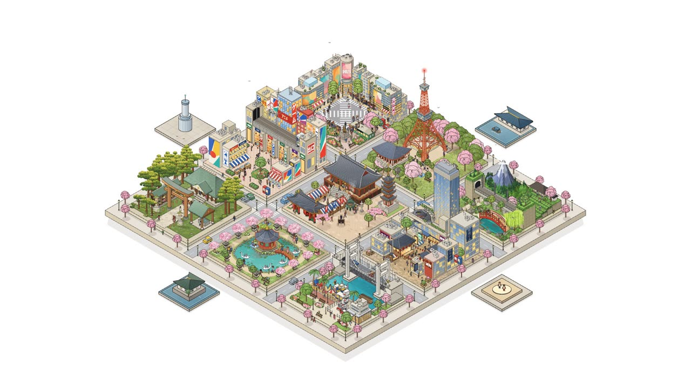
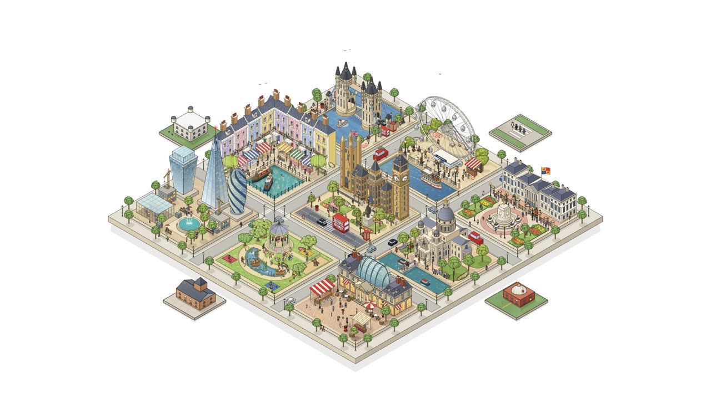
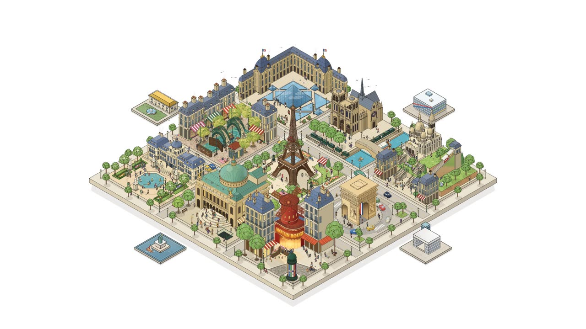
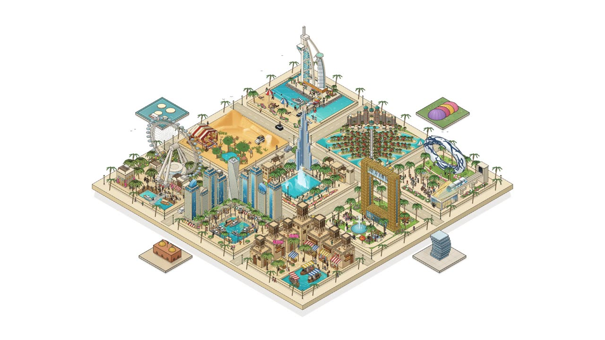
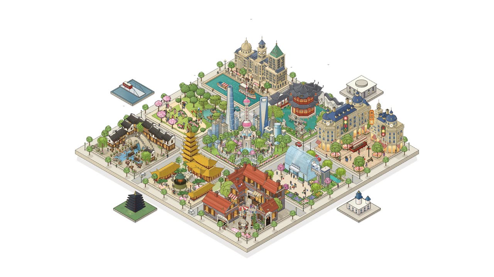

# World Cities

Five cities as living isometric miniatures: Tokyo, London, Paris, Dubai and Shanghai. Every building,
person, boat and train is drawn and animated in code with Canvas 2D. No images, no video, no 3D engine.

**Watch them live: https://zerowing.in/cities/**



| | |
|---|---|
|  |  |
|  |  |

Each city is nine landmark tiles on one isometric grid with streets between them: 45 tiles in all. Things
happen in them. Shibuya crossing floods on the green light, Tower Bridge opens for a boat, the Shinkansen
passes Mt Fuji, the fountain builds under the Burj Khalifa.

## Run it

It is static files. Any web server works:

```
git clone https://github.com/MuhammadaliMS/world-cities.git
cd world-cities
python3 -m http.server 8080
```

Then open http://localhost:8080/ for the gallery, or http://localhost:8080/city.html?city=tokyo for one city
(`tokyo`, `london`, `paris`, `dubai`, `shanghai`). Add `&t=48` for one frozen frame.

## Make your own city

[PROMPTS.md](PROMPTS.md) has three prompts you can paste into a coding agent:

1. **One living tile, from scratch**: a single HTML file, nothing else needed.
2. **Add one tile to this engine.**
3. **A whole new city**, nine tiles.

The rules that make nine separately drawn tiles read as one city are in [docs/GRID-RULES.md](docs/GRID-RULES.md).
The drawing kit is described in [docs/KIT.md](docs/KIT.md). `cities/example.js` and `vtiles/example/0_0.js`
are the smallest complete city and tile, made to be copied.

## How it works

- **One grid.** A tile is a 10 x 10 unit square. One function, `P(u, v, z)`, projects every point, every wall
  runs along `u` or `v`, and nothing on the ground leaves the tile. That is why 45 tiles line up.
- **A drawing kit** (`lib/vec-kit.js`): boxes, roofs, domes, windows, water, trees, lamps, cars, and a depth
  queue so people pass in front of and behind things.
- **People that walk** (`lib/vec-people.js`): a jointed figure whose step phase comes from the distance
  walked, so feet stay planted. Routes are smooth splines with pauses at the ends.
- **Time is the only input.** Every tile is `draw(k, t)`: a pure function of time. It can be scrubbed, looped
  and rendered frame by frame to video.
- **The city stage** (`lib/world-stage.js`, `lib/city-base.js`): the plate, the streets, cars that never meet
  at a junction, walkers on the pavements, and a camera that fits each tile's close-up to its real silhouette.
- **The live player** (`lib/live-city.js`, `lib/tile-worker.js`): drawing a whole city on one thread takes
  40-90 ms a frame, so each tile is drawn by a worker and sent back as a bitmap. The page thread draws only
  the streets and stacks the tiles in depth order, so the camera stays smooth.

## What is where

```
city.html            one city, live (the player)
index.html           the gallery
cities/<id>.js       a city: its name, the nine tile names, street colours
vtiles/<id>/         the tiles: <gx>_<gy>.js, plus landmark modules and helpers
lib/                 the kit, the people rig, the stage, the live player
tools/               screenshots of a tile, the grid audit, speed tests
render.mjs           renders a city to a 52 s film (Playwright + ffmpeg)
docs/                the grid rules and the kit guide
```

## Tools

The tools need Node 20 or newer, then `npm install` and `npx playwright install chromium`. Rendering video
also needs `ffmpeg`.

```
node tools/trace-shot.mjs tokyo 0,0 --mode code --t 3      # one tile -> out/trace/
node tools/audit-tiles.mjs tokyo 0,0                       # the grid audit
node render.mjs tokyo --fps 60                             # the film -> out/tokyo.mp4
```

## Notes

- The tiles were traced from AI-generated reference paintings, used only as a guide to what belongs in each
  tile. The paintings are not in this repo and no picture is used at run time. Without them, the `split`,
  `onion` and `ref` modes of `tools/trace-shot.mjs` show only the code.
- Built with Claude Code.

## Licence

MIT. See [LICENSE](LICENSE).
